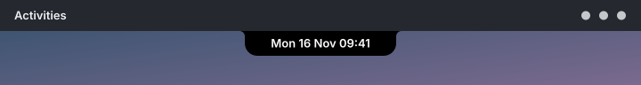
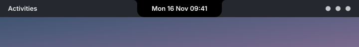
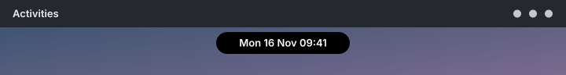
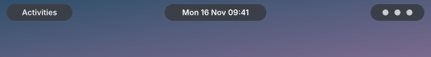
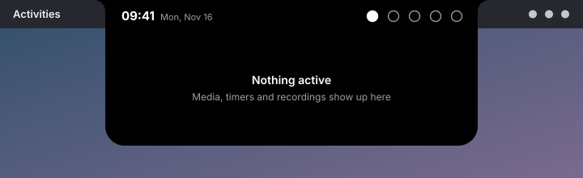

<p align="center">
  
</p>

<h1 align="center">Nexsland</h1>

<p align="center"><strong>A living, morphing status island for GNOME Shell.</strong></p>

Nexsland turns the top of your GNOME screen into a fluid, glanceable island for media,
system HUDs and live activities. It is slim while something is happening and opens into a
tabbed panel when you hover it, with spring physics throughout. Sibling of
[NexTile](https://github.com/fresp/nexTile).

> **Status:** 0.3.0 (see the [CHANGELOG](CHANGELOG.md)). Tested on GNOME Shell 46; GNOME 51
> testing is in progress. Not yet published on extensions.gnome.org.

## Island styles

Pick one under Preferences > Island > Style. The pictures are illustrations drawn from the
extension's own outline geometry (`lib/engine/shape.js`), not screenshots.

| Style                             | Looks like                                                                    |
| --------------------------------- | ----------------------------------------------------------------------------- |
| **Attached** (default)            |          |
| **Notch**                         |                 |
| **Floating**                      |                    |
| **On an Islands or Trilands bar** |  |

Whatever the style, the island opens downwards into the panel. Here the notch, open:



- **Attached** has a flat top, concave ears that flare into the bar and rounded bottom
  corners.
- **Notch** starts at the bar's top edge and is as tall as the bar while its content fits. It
  always shows the time in place of the bar's clock. Best with a plain or Mainland bar; turn
  off "Island follows the bar's colours" to keep it black on a styled bar.
- **Floating** sits a few pixels below the bar (Vertical offset).
- With the optional **Islands** or **Trilands** bar, every style merges with the clock pill
  instead: the pill is the idle island and grows into the panel.

## Features

### The island

- **Live activities** with priorities: several can be active, the most important one shows.
  Right/middle-click dismisses, and dismissed activities can be restored.
- **Temporary HUDs** that briefly preempt live activities and queue in order.
- **Opens into a tabbed panel** on hover, click, Super+V or scrolling down (scroll up closes,
  sideways switches tabs). Home shows the current activity.
- **Clock in the island**: the top bar's clock is hidden and the idle island shows the time,
  with an optional line of your own text next to it. The open panel shows time and date in
  its header, and the clock and Super+V open the island instead of GNOME's date menu.
- **Spring-driven morphing** that keeps momentum when content changes mid-animation, with
  bouncy (default, jelly-like), smooth and snappy presets. Honors GNOME's reduced-animation
  setting.
- **Multi-monitor**: on the primary monitor, or following the focused window's monitor.
- **Lock screen (opt-in)**: activities and HUDs stay visible while locked; the panel never
  opens there.
- Hides in the overview and over fullscreen windows, except for critical notifications.

### Activities and HUDs

- **Now Playing** from any MPRIS player: artwork on the left and live bars on the right
  while closed; large rounded artwork, track info and playback controls when open.
- **Notifications in the island** instead of GNOME's banners, following GNOME's rules
  (urgency, Do Not Disturb, per-app settings); critical ones also show over the overview and
  fullscreen windows.
- **Volume, microphone and brightness** in the island instead of the stock OSD, with a level
  bar that updates in place. Falls back to the stock OSD whenever the island is not visible.
- **Battery notices**: charging, unplugged, fully charged, low (20%) and critical (10%).
- **Connectivity**: Bluetooth devices connecting (with their battery level), Wi-Fi, wired and
  VPN connections coming and going, Do Not Disturb on/off.
- **Screen recording** as a live activity with elapsed time and a stop button.
- **Microphone in use**: which apps are recording, for as long as they do. Camera use is not
  covered yet.
- **Downloads**: browser downloads in progress (name and bytes so far) and when they finish,
  detected from partial files in the Downloads folder.
- **NexTile integration**: HUDs for tiling, layout and floating changes, and a Tiling tab with
  NexTile's actions. Needs External control turned on in NexTile.

Each of these is a switch under Preferences > Activities.

### Panel tabs

| Tab               | What it does                                                                                                                                                      |
| ----------------- | ----------------------------------------------------------------------------------------------------------------------------------------------------------------- |
| **Home**          | The current activity, with its controls.                                                                                                                          |
| **Notifications** | The shell's notifications with Do Not Disturb, Clear, activate and dismiss.                                                                                       |
| **Timer**         | A countdown, or a Pomodoro run of focus and break rounds ending on a long break. A live activity while it runs.                                                   |
| **Today**         | A checklist for today and the coming days. A task with a time is announced a few minutes early and stays on the island from its time on, until ticked or snoozed. |
| **Calendar**      | A month grid with your events (Evolution / Online Accounts calendars): browse months, click a day, open the calendar app.                                         |
| **System**        | CPU, memory and network throughput, read only while the tab is open.                                                                                              |
| **Clipboard**     | Opt-in history of recent text copies, kept in memory only.                                                                                                        |

Each tab is a switch under Preferences > Panel.

### Top bar styling (optional)

Continued from Open Bar and off by default (Preferences > Look): Mainland, Floating, Islands
and Trilands bars with your colours, border, neon glow, hover effect and shadow, and a solid
bar while a window is maximized. The island follows the bar's fill, text, border and glow.

### Privacy

No network access, no telemetry, no bundled binaries. The Today list and Pomodoro lengths are
stored in GSettings; the clipboard history is never written to disk.

## Install from source

Requires `glib-compile-schemas`, `make`, `zip` and Node.js 22 for the checks.

```bash
git clone https://github.com/fresp/nexsland.git
cd nexsland
make install
```

Log out and back in (Wayland) so GNOME Shell sees the extension, then:

```bash
gnome-extensions enable nexsland@fresp.github.io
```

## Development

```bash
npm ci
make check    # prettier, eslint, unit tests, strict schema compile
make nested   # install and run a nested Wayland gnome-shell to try changes
make log      # follow Nexsland's journal output
```

Unit tests cover the GI-free core (`lib/engine`, provider models). Anything that touches St,
Clutter or D-Bus is verified in a nested shell. See [AGENTS.md](AGENTS.md) for the layout and
rules.

## Releases

| Version | Highlights                                                                                  |
| ------- | ------------------------------------------------------------------------------------------- |
| 0.1.0   | First release.                                                                              |
| 0.2.0   | Top bar styling, clock and notifications in the island, Notifications tab, calendar events. |
| 0.3.0   | Notch style, Pomodoro mode, Today tab.                                                      |

Details are in the [CHANGELOG](CHANGELOG.md). Still open: camera-in-use indicator, wider
GNOME 51 testing and the extensions.gnome.org submission.

## Credits

Inspired by [Atoll](https://github.com/Ebullioscopic/Atoll) and
[DynamicNotch](https://github.com/jackson-storm/DynamicNotch) for macOS. Nexsland is an
independent reimplementation for GNOME. Top bar styling continues
[Open Bar](https://github.com/neuromorph/openbar) by neuromorph. See [NOTICE](NOTICE).

## License

[GPL-3.0-or-later](LICENSE).
