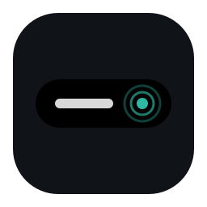

<p align="center">
  
</p>

<h1 align="center">Nexsland</h1>

<p align="center"><strong>A living, morphing status island for GNOME Shell.</strong></p>

Nexsland turns the top of your GNOME screen into a fluid, glanceable island for media,
system HUDs and live activities. Like a notch, it hangs from the top bar: slim while
something is happening, opening into a full panel when you hover it, with spring physics
throughout. Sibling of [NexTile](https://github.com/fresp/nexTile).

> **Status: Phase 0.2.** Now Playing, OSD, battery, connectivity, screen recording and
> microphone activities are in place; none of it has been tested on a real shell yet.
> Expect rough edges; not yet published on extensions.gnome.org.

## Features

- **Live activities** with priorities: several can be active, the most important one shows.
  Right/middle-click dismisses, and dismissed activities can be restored.
- **Temporary HUDs** that briefly preempt live activities and queue in order.
- **Notch-style shell** attached to the top bar, with concave ears and rounded bottom
  corners. A floating pill style is available in Preferences.
- **Open on hover** (or click); move away and it closes.
- **Now Playing** from any MPRIS player: artwork on the left and live bars on the right
  while closed; large rounded artwork, track info and playback controls when open.
- **Spring-driven morphing** that keeps momentum when content changes mid-animation, with
  bouncy (default, jelly-like), smooth and snappy presets. Honors GNOME's reduced-animation
  setting.
- **Volume, microphone and brightness** in the island instead of the stock OSD, with a level
  bar that updates in place. Falls back to the stock OSD whenever the island is not visible.
- **Battery notices**: charging, unplugged, fully charged, low (20%) and critical (10%).
- **Connectivity**: Bluetooth devices connecting (with their battery level), Wi-Fi, wired and
  VPN connections coming and going, Do Not Disturb on/off.
- **Screen recording** as a live activity with elapsed time and a stop button.
- **Microphone in use**: which apps are recording, for as long as they do. Camera use is not
  covered yet.
- Hides in the overview and over fullscreen windows.

## Install from source

Requires `glib-compile-schemas`, `make`, `zip` and Node.js 22 for the checks.

```bash
git clone https://github.com/fresp/nexsland.git
cd nexsland
make install
```

Log out and back in (Wayland) so GNOME Shell sees the extension, then:

```bash
gnome-extensions enable nexsland@fresp.github.io
```

## Development

```bash
npm ci
make check    # prettier, eslint, unit tests, strict schema compile
make nested   # install and run a nested Wayland gnome-shell to try changes
make log      # follow Nexsland's journal output
```

Unit tests cover the GI-free core (`lib/engine`, provider models). Anything that touches St,
Clutter or D-Bus is verified in a nested shell. See [AGENTS.md](AGENTS.md) for the layout and
rules.

## Roadmap

| Phase | Scope                                                                                                              |
| ----- | ------------------------------------------------------------------------------------------------------------------ |
| 0     | Engine, spring morph, island surface, Now Playing (MPRIS). Validate animation cost and geometry.                   |
| 0.1   | Volume/brightness OSD in the island, battery and charging HUDs (UPower). First EGO submission.                     |
| 0.2   | Bluetooth, Wi-Fi and VPN events, Do Not Disturb, screen-recording and mic indicators (code done; camera deferred). |
| 0.3   | Expanded panel tabs: timer, calendar, system stats, opt-in clipboard history. Hover and scroll gestures.           |
| 0.4   | Lock-screen widgets, multi-monitor, downloads (heuristic), NexTile integration.                                    |

Open design question: whether the island should eventually take over the clock slot in the
top bar. It currently hangs just below the bar, so the clock stays where it is.

## Credits

Inspired by [Atoll](https://github.com/Ebullioscopic/Atoll) and
[DynamicNotch](https://github.com/jackson-storm/DynamicNotch) for macOS. Nexsland is an
independent reimplementation for GNOME; see [NOTICE](NOTICE).

## License

[GPL-3.0-or-later](LICENSE).
